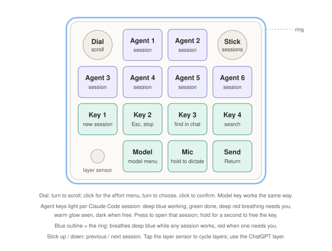

# claude-micro

Drive Claude from a Work Louder **Creator Micro 2** (or Codex Micro) and see
Claude's status on its lights: sessions on this Mac and sessions on a server
you drive by Remote Control, side by side on the six agent keys.

**Status: experimental and unofficial.** Built for one desk and shared as is.
It is not affiliated with Work Louder, OpenAI or Anthropic, and it relies on
behaviour of the pad's firmware, the Claude desktop app and Claude Code that
any update may change. macOS only.



## What it does

- **Keys drive Claude.** Return, Esc, previous/next session, the effort and
  model menus, scrolling, and dictation through Wispr Flow, each sent only while
  the Claude desktop app (or iTerm running Claude Code) is the frontmost app.
- **Lights show Claude Code sessions.** Each session takes one of the six
  agent keys and keeps it: blue breathing while working, green when done,
  deep red breathing when it needs you, a soft warm glow once you have looked. Pressing the key
  opens that session in the desktop app. The ring follows the session you
  last submitted to.
- **It yields to ChatGPT.** While the ChatGPT desktop app runs it releases the
  pad and reclaims it when ChatGPT quits (the pad serves one host at a time).

Sessions on other machines count too: a Claude Code session you drive by
Remote Control on a server (or over ssh) reports through a small relay, so it
gets a key like a local one. See "Sessions on a server" below.

## Controls (Claude desktop app)

| Control | Action |
| --- | --- |
| Agent keys 1 to 6 | one Claude Code session each; press to open it, hold for a second to free the key |
| Key 1 | Cmd+N, new session |
| Key 2 | Esc, stop the current response |
| Key 3 | opens the lit session that most needs you: red first, then working, then finished |
| Key 4 | Cmd+Shift+K, search across sessions |
| Stick up / down | Cmd+Shift+[ / ], previous / next session |
| Model (bottom row, left) | Cmd+Shift+I model menu; then dial to choose, dial click to confirm |
| Mic (bottom row, middle) | hold to dictate with Wispr Flow (hands-free start on press, stop on release) |
| Send (bottom row, right) | Return |
| Dial turn | scroll the conversation (aimed at the Claude window, pointer put back) |
| Dial click | Cmd+Shift+E effort menu; then dial to choose, click to confirm |
| Layer sensor (small round touch spot) | cycles layers; stay on the ChatGPT layer |

In iTerm (Claude Code): Return, Esc, Cmd+Shift+[ / ] for tabs, Shift+Up /
Shift+Down on the dial for effort, mic key as above. Keys do nothing in any
other app.

## How this differs from the other pad projects

Several good projects already drive this pad. This one exists for a
combination none of them covered when I looked (November 2026):

- **Sessions on other machines count.** Claude Code sessions you run on a
  server by Remote Control, or over ssh, light the agent keys and open in the
  desktop app on a press, through a small relay. Every other project I found
  shows sessions on the local machine only.
- **Local sessions count too.** Sessions in the Claude desktop app, and in
  iTerm, get keys the same way. Both kinds share the six keys.
- **Aimed at the Claude desktop app.** Keys send the app's own shortcuts,
  only while it is frontmost, and a session key opens that session through
  the app's own session links, including Remote Control sessions.
- **Stock pad, no flashing, no keymap surgery.** It uses the ChatGPT preset
  that Work Louder's Input app installs on a Creator Micro 2, and the same
  vendor protocol the ChatGPT app speaks. Nothing is written to the pad's
  firmware or keymap.
- **The pad's quirks are handled.** Dial detents arrive as a different event
  code, a held key auto-repeats as press/release pairs, a key's release can
  arrive as a second event, and some presses double-report. The helper filters
  all of that, and the README says so, which took a while to learn.
- **Runs itself.** A login item, a doctor that names what is missing, a
  yielding rule for the ChatGPT app, and an uninstall script that restores
  your settings.

For comparison, as their READMEs described them at the time:
[alasano/house-of-herdr](https://github.com/alasano/house-of-herdr)
(`codex-micro`) drives the Herdr terminal multiplexer and is where this
project's device layer comes from;
[RobbieTheWagner/opencode-codex-micro](https://github.com/RobbieTheWagner/opencode-codex-micro)
does the same for OpenCode, locally;
[honest-andy/cm2-agent-keys](https://github.com/honest-andy/cm2-agent-keys)
is a library with a local Claude Code and iTerm example and documented the
protocol for the Creator Micro 2;
[gotalab/creator-micro-setup](https://github.com/gotalab/creator-micro-setup)
targets the Claude desktop app with ordinary keystrokes from a second Input
layer rather than the vendor protocol. If one of those fits your setup better,
use it; they are all small and readable.

## Tested with

| Component | Version |
| --- | --- |
| Creator Micro 2 firmware | 0.6.3, over Bluetooth |
| Work Louder Input | 1.1.0 (ChatGPT preset installed on the pad) |
| Claude desktop app | 6.6395.1 |
| Claude Code | 2.1.x (hooks, local and on the server) |
| macOS | 26 (Tahoe), Apple silicon |
| Node | 23 (22 or newer should work) |

Defaults that are mine and easy to change in `config.json`: the mic key drives
Wispr Flow, and the server relay uses ntfy.sh. See "Changing the key map" and
"Sessions on a server".

## Requirements and permissions

- macOS 14 or newer, Node 22 or newer, firmware 0.6.3 or newer on the pad.
- The **ChatGPT preset** installed on the pad from Work Louder's Input app
  (Preset tab, add, ChatGPT), and the pad switched to that layer. Quit Input
  while the helper runs; it competes for the lights.
- **Input Monitoring** (to read the pad) and **Accessibility** (to send keys),
  granted in System Settings > Privacy & Security to whatever runs the helper:
  the terminal app for a manual run, and the `node` binary for the login item
  (`node bin/claude-micro.js doctor` prints the exact path).
- Wispr Flow for dictation, or rebind the mic key.

## Install

```bash
git clone https://github.com/spamr/creator-micro2-claude.git && cd creator-micro2-claude
npm install                              # also compiles the keystroke helper (needs Xcode command line tools)
node bin/claude-micro.js hooks diff      # review the Claude settings change
node bin/claude-micro.js hooks install   # backs up ~/.claude/settings.json first
node bin/claude-micro.js agent install   # login item; starts now and at login
node bin/claude-micro.js doctor          # says exactly what is missing
```

`uninstall.sh` removes the login item and the hooks (`--restore-settings` puts
the pre-install settings file back). Backups live next to
`~/.claude/settings.json` with a `.claude-micro-backup` suffix.

## Commands

| Command | Purpose |
| --- | --- |
| `node bin/claude-micro.js run` | run in the foreground (the login item exits while a manual copy runs) |
| `... doctor` | check pad, layer, permissions, helper, hooks, login item |
| `... status` / `stop` | talk to the running helper |
| `... keys` / `keys free N` | list what each agent key holds, or free a key by hand |
| `... config` | print the parsed key map |
| `... probe [colour]` | raw pad events and a ring colour, for debugging |
| `... hooks diff / install / uninstall / status` | manage the Claude Code hooks |
| `... agent install / uninstall / status / plist` | manage the login item |

Logs: `state/helper.log` for the login item; a manual run prints to the terminal.

## Changing the key map

Edit `config.json`; the running helper reloads it within a second or two and
keeps the old map if the new file is invalid (the log says why). Bindings are
grouped by the bundle id of the app that must be frontmost. Inputs: `ACT06`
to `ACT09` (command keys, left to right), `ACT10` and `ACT11` (bottom row,
left and middle), `ACT12` (Send), `ENC_CW` / `ENC_CC` (dial turn), `ENC_CLK`
(dial click), `joystick.up/down/left/right`.

```json
"ACT07": { "key": "escape" }
"ACT10": { "key": "space", "hold": true }
"ENC_CW": { "scroll": 3, "window": "Claude", "at": [0.5, 0.4] }
"ACT11": { "exec": ["open", "-g", "wispr-flow://start-hands-free"],
           "release": ["open", "-g", "wispr-flow://stop-hands-free"] }
"ENC_CLK": { "key": "cmd+shift+e",
             "menu": { "ENC_CW": { "key": "down" }, "ENC_CC": { "key": "up" }, "ENC_CLK": { "key": "return" } } }
```

`key` names: letters, digits, `return`, `escape`, `tab`, `space`, `delete`,
arrows, `f1`-`f20`, `[`, `]`, `-`, `=`, `/`, and bare modifiers such as `fn`
or `rcmd` (always held). Modifiers: `cmd`, `shift`, `alt`/`opt`, `ctrl`.
`menu` re-binds the dial for six seconds after the key fires.
`{"session": "urgent"}` opens the lit session that most needs you;
`{"session": "next"}` and `"prev"` step through the lit keys in order.
`agent_key_order` lists which agent keys sessions may use, in order; keys left
out are never used, for example `[1, 3, 4, 5, 6]` to retire a faulty switch.
`session_expiry_hours` (default 4) is how long a finished or idle session may
stay silent before its key is given back.

## When a key is taken

A session keeps its key until it ends, until it has been silent for
`session_expiry_hours`, until you hold its key for a second, or until all six
keys are busy and a newer session evicts the stalest finished one. Sessions on
a server that were not started under Remote Control still light a key (their
status is real) but a press cannot open them, since there is no window for
them anywhere; hold the key to free it.

## How it works, briefly

The pad's ChatGPT layer speaks a small JSON-RPC protocol over a vendor HID
interface: key events arrive as notifications, and two methods set the six key
lights and the ring. The helper (`src/device.js`, `src/framing.js`) opens that
interface non-exclusively with node-hid. Keystrokes go through a tiny C helper
(`native/tapkey.c`) that posts real modifier sequences and only while an
allowed app is frontmost. Claude Code hooks append one line per event to
`state/events.jsonl`; the helper tails it (`src/sessions.js`) and opens a
session by the desktop app's `claude://code/continue?session=...` link.

## Sessions on a server (Remote Control, ssh)

Hooks run where the session runs, so a session on another machine cannot write
to this Mac directly. Instead its hooks publish one small JSON message per
event (session id, event name, folder name) to a private topic on
[ntfy.sh](https://ntfy.sh), and the helper streams that topic. The topic is a
long random name generated once into `state/relay.json`; keep it private.

```bash
node bin/claude-micro.js cloud setup          # creates the topic, prints instructions
node bin/claude-micro.js cloud test           # fake session through the relay: a key should light
node bin/claude-micro.js cloud remote-install > state/remote-install.sh
ssh SERVER 'sh -s' < state/remote-install.sh  # installs the hook on the server (backs up its settings)
```

The server needs `curl` and `python3`. Sessions already running pick the hooks
up on their next turn. Pressing a server session's key marks it seen; nothing
opens, since the window is elsewhere. Anthropic-hosted cloud sessions can use
the same relay through the environment's setup script and a network allowlist
entry for `ntfy.sh` (`cloud setup` prints the block); that path is untested.

## Known limits

- Unofficial. Any update to the pad's firmware, Work Louder's Input app, the
  Claude desktop app, or Claude Code can change the behaviour this relies on.
- One host at a time: the ChatGPT app owns the pad while it runs.
- Sessions elsewhere need the relay hook installed on that machine; Anthropic-hosted
  cloud sessions are untested with it.
- Plain chats in the desktop app run no hooks and get no light.
- The pad auto-repeats held keys and double-reports some presses; the helper
  filters this, so a deliberate double press must be slower than 150 ms.
- Over Bluetooth, holding the layer touch sensor starts a new pairing and
  drops the current one; tap it instead. USB avoids this.
- The model and effort menus toggle: a second press closes them.
- Keystrokes are typed as a US layout.

## Contributing

Issues with the output of `node bin/claude-micro.js doctor` and the relevant
lines of `state/helper.log` are the most useful. Pull requests welcome, in
particular for other dictation tools, other terminals, Windows or Linux, and
confirmed results on the Codex Micro or over USB.

## Credits

Device discovery, framing, lighting and the keystroke helper are adapted from
[alasano/house-of-herdr](https://github.com/alasano/house-of-herdr)
(`packages/codex-micro`, MIT, Aljosa Asanovic), with Creator Micro 2 support
from its pull request 4 by malud. Protocol notes by Andy Aitken
(`cm2-agent-keys`) confirmed the Creator Micro 2 details. See
`THIRD_PARTY.md`.
